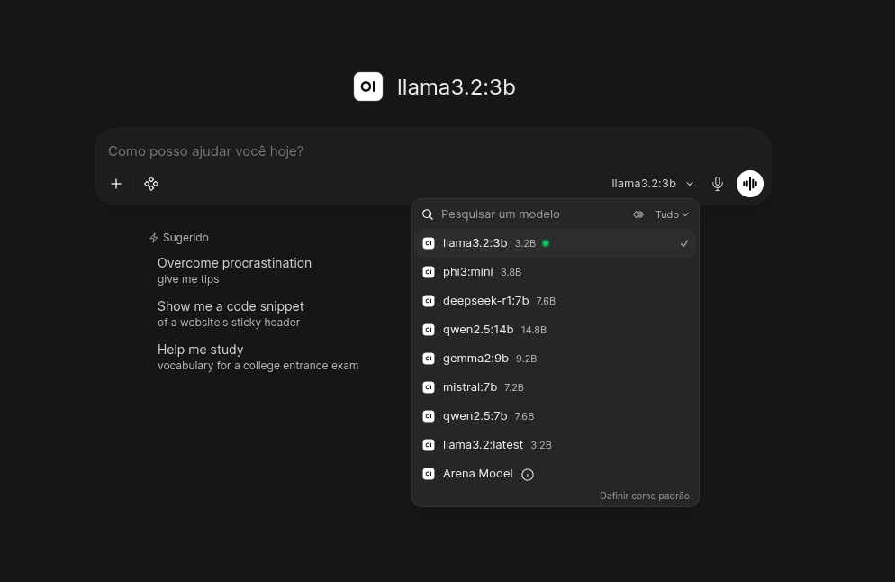
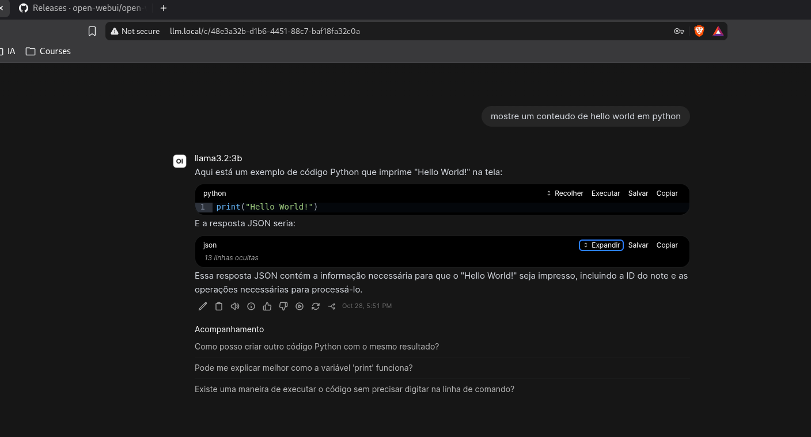

# LLM local com Ollama e Open WebUI

Manifestos e scripts para instalar uma stack local de LLM em clusters
Kubernetes compatíveis. Não há dependência de IP de host, distribuição
específica ou caminho de disco local: o PVC usa a StorageClass padrão do
cluster, ou a classe indicada pelo operador.

## O que é instalado

- Ollama, com os modelos guardados em um PVC persistente;
- Open WebUI, acessível por Ingress e/ou NodePort;
- um modelo padrão selecionado na interface;
- opcionalmente, CronJobs para atualizar os modelos (`models.txt`) e a interface Open WebUI.

## Pré-requisitos

- Bash 4 ou superior;
- `kubectl` configurado para o cluster de destino;
- `envsubst` (normalmente fornecido pelo pacote `gettext`/`gettext-base`);
- uma StorageClass padrão, ou definir `OLLAMA_STORAGE_CLASS`;
- recursos suficientes no nó para as solicitações configuradas.

Confira o contexto antes de instalar:

```bash
kubectl config current-context
kubectl get nodes
kubectl get storageclass
```

Os scripts não instalam um controller Ingress nem uma StorageClass. Esses
recursos devem existir no cluster se forem necessários. Sem classe de Ingress
detectada, o deploy omite o Ingress e mantém o acesso via NodePort.

## Instalação

Execute `deploy.sh` a partir desta pasta:

```bash
./deploy.sh
```

O script renderiza os templates, aplica os recursos, aguarda os Deployments e,
por padrão, baixa os modelos definidos em `models.txt` apenas quando o Ollama
ainda não tem modelos. Reexecutar o deploy preserva os modelos instalados.
Para pular o download inicial:

```bash
PULL_MODELS_ON_DEPLOY=false ./deploy.sh
```

O PVC `ollama-data` solicita `100Gi`. O tamanho pode ser configurado antes da
criação. Confirme a capacidade e a expansão de volumes suportadas pelo cluster
antes de alterar PVCs existentes.

## Configuração para outros ambientes

Os padrões servem como ponto de partida. Defina variáveis de ambiente para
adaptar a instalação; por exemplo:

```bash
export LLM_NAMESPACE=local-llm
export OLLAMA_STORAGE_CLASS=standard
export OLLAMA_STORAGE_SIZE=80Gi
export LLM_INGRESS_CLASS=nginx
export LLM_INGRESS_HOST=llm.example.test
export WEBUI_SERVICE_TYPE=ClusterIP
./deploy.sh
```

Configurações disponíveis:

| Variável | Padrão | Uso |
|---|---|---|
| `LLM_NAMESPACE` | `ms-local-llm` | Namespace da stack |
| `OLLAMA_STORAGE_CLASS` | StorageClass padrão do cluster | Classe de armazenamento do PVC |
| `OLLAMA_STORAGE_SIZE` | `100Gi` | Capacidade solicitada para os modelos |
| `OLLAMA_IMAGE` | `ollama/ollama:latest` | Imagem do Ollama e do Job agendado |
| `OPEN_WEBUI_IMAGE` | `ghcr.io/open-webui/open-webui:main` | Imagem da interface |
| `LLM_INGRESS_CLASS` | Classe padrão ou única disponível | Classe do Ingress; vazio desabilita Ingress |
| `LLM_INGRESS_HOST` | `llm.local` | Host publicado pelo Ingress |
| `WEBUI_SERVICE_TYPE` | `NodePort` | Tipo do Service (`NodePort` ou `ClusterIP`) |
| `WEBUI_AUTH` | `True` | Autenticação da interface |
| `DEFAULT_MODEL` | `llama3.2` | Modelo selecionado inicialmente na interface |
| `OLLAMA_CPU_REQUEST` / `OLLAMA_CPU_LIMIT` | `2` / `8` | CPU solicitada e limite do Ollama |
| `OLLAMA_MEMORY_REQUEST` / `OLLAMA_MEMORY_LIMIT` | `4Gi` / `16Gi` | Memória solicitada e limite do Ollama |
| `WEBUI_CPU_REQUEST` / `WEBUI_CPU_LIMIT` | `250m` / `1` | CPU solicitada e limite do Open WebUI |
| `WEBUI_MEMORY_REQUEST` / `WEBUI_MEMORY_LIMIT` | `1Gi` / `3Gi` | Memória solicitada e limite do Open WebUI |

Para persistir as variáveis entre comandos, carregue-as de um arquivo local
protegido, não versionado. Não inclua segredos ou configurações específicas da
rede em commits.

O arquivo `configure-k3s-data-dir.sh` é um utilitário legado de migração do
host k3s original, com caminhos fixos desse host. Ele não é chamado por
`deploy.sh` e não deve ser executado em outros ambientes sem revisão e
adaptação.

## Acesso

Com Ingress, abra `http://<LLM_INGRESS_HOST>`. Configure DNS para esse host
apontar ao endereço publicado pelo controller Ingress. Para testes locais, no
computador cliente, adicione uma entrada ao arquivo `hosts`, usando o IP do
Ingress/nó:

```text
<IP_DO_INGRESS> <LLM_INGRESS_HOST>
```

No Linux:

```bash
echo "<IP_DO_INGRESS> ${LLM_INGRESS_HOST:-llm.local}" | sudo tee -a /etc/hosts
```

No Windows, edite como administrador
`C:\Windows\System32\drivers\etc\hosts`.

Se o Service estiver como `NodePort`, consulte a porta alocada:

```bash
kubectl get service open-webui -n "${LLM_NAMESPACE:-ms-local-llm}"
```

Então acesse `http://<IP_DE_UM_NODE>:<NODE_PORT>`. O Ollama não é publicado
externamente; os clientes dentro do cluster podem acessá-lo em
`http://ollama.<namespace>.svc.cluster.local:11434`.

### Primeiro acesso e login inicial

O Open WebUI vem com autenticação ativada por padrão (`WEBUI_AUTH=True`), mas não possui credenciais pré-configuradas de fábrica. O primeiro usuário a se cadastrar torna-se automaticamente o **administrador**:

1. **Cadastro inicial (Sign Up)**: Ao acessar a interface pela primeira vez, o sistema solicita:
   - **Nome**: o seu nome ou identificação (ex.: seu nome ou `Admin`);
   - **E-mail**: endereço de e-mail de acesso (ex.: `admin@local` ou seu e-mail pessoal);
   - **Senha**: a senha de acesso (para laboratório/testes locais, pode definir por exemplo `admin`, ou uma senha forte para ambientes compartilhados).
2. **Papel de administrador**: Como é o primeiro cadastro, essa conta recebe privilégios totais de **Administrador**.
3. **Login nos acessos seguintes (Sign In)**: Para entrar novamente no sistema, a tela de login solicita apenas o **E-mail** e a **Senha** definidos no cadastro. O administrador pode gerenciar configurações, usuários e permissões através do menu **Admin Panel**.

> **Nota**: Por padrão, o volume de dados do Open WebUI utiliza `emptyDir`. Se o pod for recriado, os dados da interface (usuários cadastrados e histórico) são reiniciados, fazendo com que o sistema solicite novamente o cadastro inicial (Nome, E-mail e Senha) no próximo acesso. Os modelos de IA não são afetados, pois ficam salvos no PVC persistente do Ollama.

### Interface da aplicação

Após realizar o acesso e o cadastro inicial, a interface do Open WebUI permite selecionar os modelos locais e interagir via prompt:

#### Seleção de modelos

O menu superior lista todos os modelos locais disponíveis e gerenciados pelo Ollama:



#### Consulta no prompt

Exemplo de consulta e resposta gerada localmente pelo modelo através da interface web:




## Atualizar os modelos

Os nomes dos modelos administrados pela rotina ficam em `models.txt`, um por
linha. Edite essa lista para adicionar/remover modelos. Baixar um modelo novo
ou atualizar um já instalado pode transferir vários gigabytes.

Atualização manual de todos os modelos da lista:

```bash
./update-models.sh
```

Atualizar somente modelos escolhidos:

```bash
./update-models.sh --manual llama3.2 qwen2.5:7b
```

O `ollama pull` baixa a versão mais recente associada à tag do modelo e
preserva o armazenamento do PVC.

### Adicionar modelos do Hugging Face

O Ollama pode baixar modelos publicados como GGUF no Hugging Face usando o
identificador `hf.co/<usuario>/<repositorio>[:quantizacao]`. Escolha uma
quantização disponível no repositório; se ela for omitida, o Ollama usa sua
quantização padrão. Por exemplo, para baixar o Qwen 2.5 7B Instruct GGUF na
quantização Q4_K_M:

```bash
./update-models.sh --manual hf.co/unsloth/Qwen2.5-7B-Instruct-GGUF:Q4_K_M
```

Para manter o modelo na lista administrada e incluí-lo nas próximas
atualizações, adicione o identificador como uma linha em `models.txt`:

```text
hf.co/unsloth/Qwen2.5-7B-Instruct-GGUF:Q4_K_M
```

Depois execute `./update-models.sh` para baixá-lo. Para que o CronJob agendado
também passe a atualizá-lo, reaplique a agenda escolhida:

```bash
./update-models.sh --schedule weekly
# ou
./update-models.sh --schedule monthly
```

Confira no Hugging Face se o repositório contém uma versão GGUF e se o nome da
quantização corresponde exatamente a um arquivo disponível. Modelos e
quantizações diferentes podem exigir muito mais espaço em disco e memória;
verifique os requisitos antes de adicioná-los à lista.

## Agendar atualizações automáticas

O script cria um CronJob no cluster que atualiza sequencialmente os modelos
listados em `models.txt`. Escolha uma das periodicidades:

```bash
./update-models.sh --schedule weekly
./update-models.sh --schedule monthly
```

O agendamento semanal ocorre domingo às 03:00; o mensal, no primeiro dia do
mês às 03:00, usando o fuso horário local do `kube-controller-manager` (que
pode não ser o fuso do seu computador). Uma execução ativa impede que outra
comece em paralelo. Consulte ou desative a rotina:

```bash
./update-models.sh --status
./update-models.sh --disable
```

Se `models.txt` mudar depois da criação do CronJob, execute novamente o comando
`--schedule` escolhido para atualizar o ConfigMap usado pelas próximas
execuções. As alterações do ConfigMap não interrompem um Job já em andamento.

## Atualizar o Open WebUI

O Open WebUI exibe notificações na interface quando novas versões são lançadas
no repositório oficial ([Open WebUI Releases](https://github.com/open-webui/open-webui/releases)).

Para atualizar a aplicação, utilize o script `update-webui.sh` (ou `update-open-webui.sh`),
estruturado nos mesmos moldes da rotina de modelos:

### Atualização manual do Open WebUI

Atualizar imediatamente para a versão mais recente da branch `main`:

```bash
./update-webui.sh
```

Atualizar para uma tag ou versão específica (por exemplo, `v0.12.4`):

```bash
./update-webui.sh --manual v0.12.4
# ou diretamente:
./update-webui.sh v0.12.4
```

O script configura a política `imagePullPolicy: Always`, atualiza a imagem no Deployment
(ou aciona o reinício do rollout) e aguarda até que o novo pod esteja pronto e saudável.

### Agendar atualizações automáticas do Open WebUI

É possível agendar a verificação e atualização periódica da imagem via CronJob no cluster:

```bash
./update-webui.sh --schedule weekly
./update-webui.sh --schedule monthly
```

O agendamento semanal ocorre aos domingos às 03:00 e o mensal no primeiro dia do mês às
03:00 (horário do cluster), com política que impede execuções concorrentes.

Para consultar a versão em execução e o agendamento ativo:

```bash
./update-webui.sh --status
```

Para remover o agendamento automático:

```bash
./update-webui.sh --disable
```


## Verificação e diagnóstico

```bash
kubectl get pods,svc,ingress,pvc -n "${LLM_NAMESPACE:-ms-local-llm}"
kubectl exec -n "${LLM_NAMESPACE:-ms-local-llm}" deploy/ollama -- ollama list
kubectl logs -n "${LLM_NAMESPACE:-ms-local-llm}" deploy/ollama
```

Os pods devem estar prontos, o PVC `ollama-data` deve estar `Bound` e `ollama
list` deve mostrar os modelos baixados.

## Hardware e segurança

### Computador de referência

Configuração do computador usado como referência para esta instalação
(informações coletadas em 23/10/2026):

| Componente | Especificação |
|---|---|
| Sistema operacional | Debian GNU/Linux forky/sid, x86_64 |
| Kernel | Linux 7.1.13+deb14-amd64 |
| Processador | AMD Ryzen 7 5700G, 8 núcleos / 16 threads, até 4,67 GHz |
| Gráficos | AMD Radeon Vega integrada; NVIDIA GeForce 210 |
| Memória RAM | 30,65 GiB |
| Swap | 12,30 GiB |
| Ambiente gráfico | Sway 1.12 (Wayland) |

Esta configuração é uma referência, não um requisito mínimo. A presença das
GPUs não significa que estejam configuradas ou disponíveis para aceleração
de inferência no Kubernetes; confirme o suporte e a configuração de runtime
de GPU no cluster antes de contar com esse recurso.

- Ollama pode executar em CPU; sem GPU compatível, a inferência pode ser lenta.
- Ajuste os requests/limits de CPU e memória para os recursos do cluster.
  Modelos maiores, como `qwen2.5:14b`, exigem mais memória e armazenamento.
- A autenticação do Open WebUI fica habilitada por padrão. Não desative nem
  exponha a interface em redes não confiáveis sem configurar autenticação,
  TLS e controles de acesso adequados. Na primeira visita, crie a conta
  administrativa inicial na própria interface.
- As tags `latest` e `main` são mutáveis. Para implantação reprodutível,
  configure imagens com versões fixas após validá-las no seu ambiente.
- O diretório de dados do Open WebUI usa `emptyDir`; o conteúdo local da
  interface pode ser perdido quando o pod é recriado. Os modelos do Ollama,
  por outro lado, ficam no PVC persistente.
